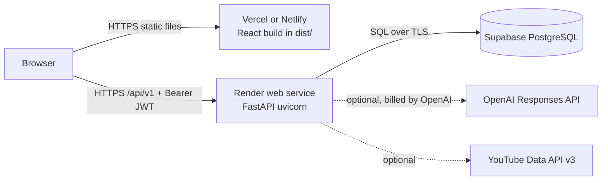
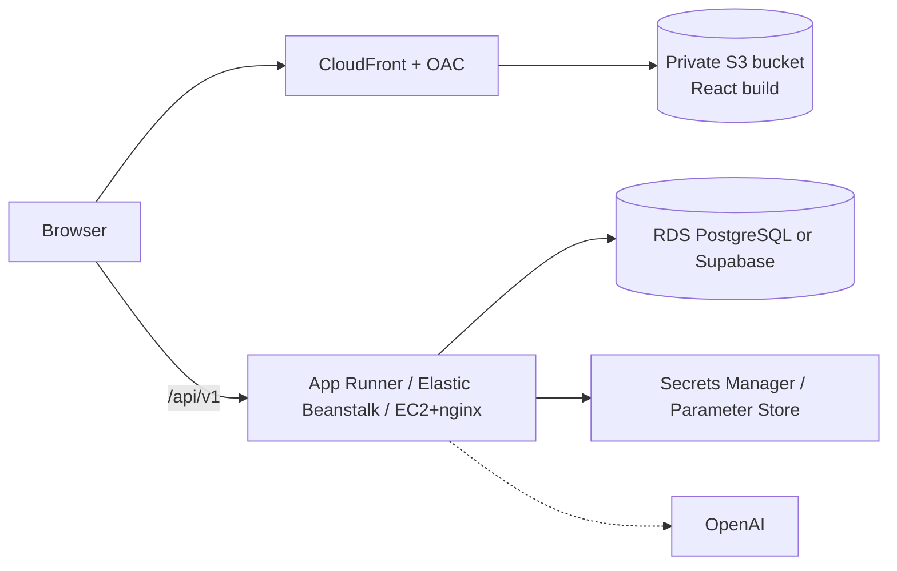
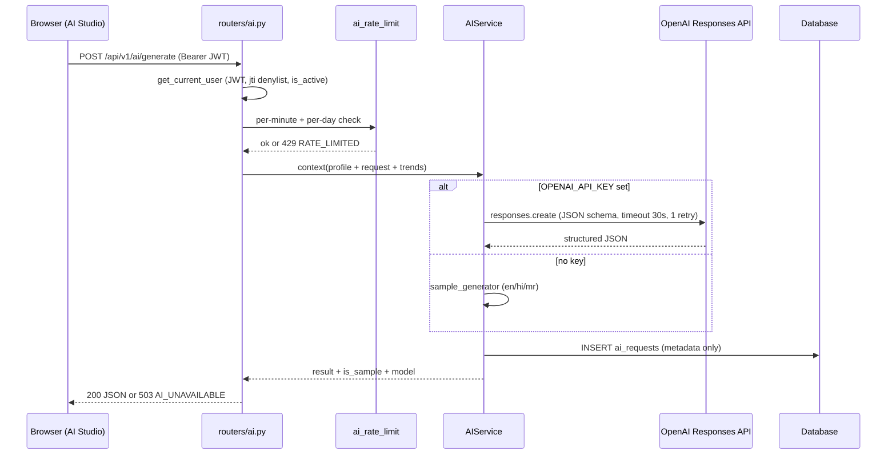
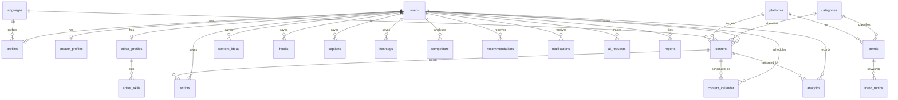

# CreatorHub AI - Architecture

Related: [DATABASE.md](DATABASE.md) | [API.md](API.md) | [CONTRACT.md](CONTRACT.md) | [Deployment guides](deployment/FREE_DEPLOYMENT.md) | [AWS notes](deployment/AWS_DEPLOYMENT.md)

## 1. Overview

A React single-page app (Vite, plain CSS, recharts) talks JSON over HTTPS to a FastAPI backend (`app.main:app`, SQLAlchemy 2.0, Pydantic v2). The backend stores data in PostgreSQL (Supabase) in production and in a SQLite file locally. AI generation uses the OpenAI Responses API when `OPENAI_API_KEY` is set and a deterministic sample generator otherwise.

## 2. Free-tier architecture

Provider free plans change; verify current terms (see [FREE_DEPLOYMENT.md](deployment/FREE_DEPLOYMENT.md)).



```
Browser --static--> Vercel/Netlify (dist/)
Browser --/api/v1 + JWT--> Render (uvicorn app.main:app) --SQL/TLS--> Supabase Postgres
                                     |--(optional)--> OpenAI Responses API
                                     `--(optional)--> YouTube Data API
```

Limits: Render free instances sleep when idle (first request is slow); Supabase free projects may pause; token revocation and rate limits are in-process memory (single instance).

## 3. AWS architecture (optional)

Details and cost caveats: [AWS_DEPLOYMENT.md](deployment/AWS_DEPLOYMENT.md), [deploy/aws/](../deploy/aws/README.md).



```
Browser -> CloudFront(OAC) -> private S3 (dist/)
Browser -> App Runner | Elastic Beanstalk | EC2+nginx -> RDS PostgreSQL / Supabase
                         `-> secrets from Secrets Manager / Parameter Store
```

If more than one backend instance runs, move the in-memory token denylist and rate limiter to a shared store (for example Redis); this is not implemented.

## 4. AI generation request data flow



Prompt construction lives in `backend/app/ai/prompts.py` and `context.py` (profile and trend data personalise prompts); the OpenAI wrapper is `ai/client.py`; schemas are in `ai/schemas.py`. `ai_requests` stores feature, language, status, model, latency and character counts only - never prompts, outputs or keys.

## 5. Demo-mode fallback design

| Condition | Behaviour |
|---|---|
| No `OPENAI_API_KEY` | `sample_generator.py` returns deterministic content, `is_sample: true`; UI shows a "Sample content" badge |
| OpenAI call fails or returns invalid/empty JSON (after one retry) | 503 `AI_UNAVAILABLE` with the friendly message; error logged server-side only |
| No `YOUTUBE_API_KEY` | trends and competitor analysis use sample public-style data, labelled `source: "sample"` / `is_sample` |
| YouTube call fails | `POST /trends/refresh` still returns 200 with `source: "sample"` |
| Supabase/OpenAI/YouTube absent | app still starts; features switch to sample mode and the reason is logged |
| Empty DB and `AUTO_SEED=true` (default in development/demo) | demo data is seeded at startup |

In `APP_ENV=production` startup refuses to run with a weak or missing `JWT_SECRET`, missing `DATABASE_URL`, wildcard CORS or `DEBUG` (see `config/settings.py`).

## 6. Formulas

**Trend Score** (`backend/app/trends/score.py`) - a project-defined analytical score, not an official platform metric:

```
score = recency (0-25) + growth (0-25) + engagement (0-25) + topic frequency (0-25), clamped to 0-100
each component = 25 x min-max-normalised input (clamped 0..1); recency is inverted (fewer days = more points)
default bounds: recency_days 0-30, growth_pct -10-300, engagement_rate 0-15, topic_frequency 0-200
```

Bounds can be derived from a dataset with `bounds_from_items`. Admin trend create/update recomputes the score server-side.

**Engagement rate** (`backend/app/analytics/engagement.py`):

```
Engagement Rate = (likes + comments + shares + saves) / reach x 100
```

If reach is missing or 0, views replace reach (`basis: "views"`, label "Engagement rate (views-based)"). A zero denominator gives 0.0, never an error.

## 7. Security model

| Layer | Control |
|---|---|
| Passwords | bcrypt hashes (`services/security.py`); minimum 8 characters; generic `Incorrect email or password.` |
| Tokens | JWT HS256, claims `sub, role, jti, exp`; logout revokes `jti` in an in-memory denylist |
| Authorization | `get_current_user`, `require_roles(...)`; user rows filtered by `user_id == current_user.id`; `/admin/*` needs role `admin` |
| Registration | roles `creator`/`editor` only; admin via seed (demo) or `python -m app.scripts.create_admin` |
| Rate limits | login 10/min/IP; AI per-minute and per-day per user (in-memory) |
| Errors | `{error:{code,message}}`; no stack traces, SQL, keys or provider text to clients |
| Transport/headers | CORS allow-list (no `*` in production); security headers middleware (`main.py`); `Cache-Control: no-store` on API responses |
| Secrets | server-side env only; `SUPABASE_*`, `OPENAI_API_KEY`, `JWT_SECRET` never sent to the frontend |
| AI privacy | `ai_requests` holds metadata only |

### Row Level Security (defense in depth)

The app uses its own JWT, not Supabase Auth, so policies cannot use `auth.uid()`. Instead, on PostgreSQL each request calls `set_rls_context(db, user_id, role)`, which runs `set_config('app.current_user_id', ..., true)` and `set_config('app.current_role', ..., true)` (transaction-local). Policies in `database/migrations/0002_row_level_security.sql` compare `user_id` with `current_setting('app.current_user_id', true)` or allow role `admin`/`system`. Register, login, reset and seed flows run as `system`.

Policy shapes: user-owned tables = owner or admin/system; reference, trends and editor tables = public SELECT, writes admin/system; `users` = self or admin/system; `reports` = reporter inserts and reads own, admin/system all; `ai_requests` = owner reads, system writes; `notifications` = owner.

**Limits (be honest in the viva):**
- RLS only binds roles without `BYPASSRLS`. Supabase's default `postgres` role bypasses it, so you must connect as the non-bypass role `creatorhub_app` for policies to apply. See [SUPABASE_SETUP.md](deployment/SUPABASE_SETUP.md).
- On SQLite (local/tests) `set_rls_context` is a no-op, so RLS is not exercised in the 109 automated tests.
- The `database/tests/` folder is empty and no document in this repo records a live PostgreSQL run of `schema.sql` RLS policies. Treat them as **unverified on a live PostgreSQL** until you run your own check.
- The context is set by the application; a compromised app can set any user id. RLS is a second layer, not a replacement for application authorization.
- In-memory revocation/rate limiting do not work across multiple instances.
- Not implemented: Google sign-in, password-reset email delivery (the reset token is logged server-side in dev/demo only).

## 8. Entity-relationship diagram (main tables)

Column-level detail: [DATABASE.md](DATABASE.md). SQL: [database/schema.sql](../database/schema.sql).


